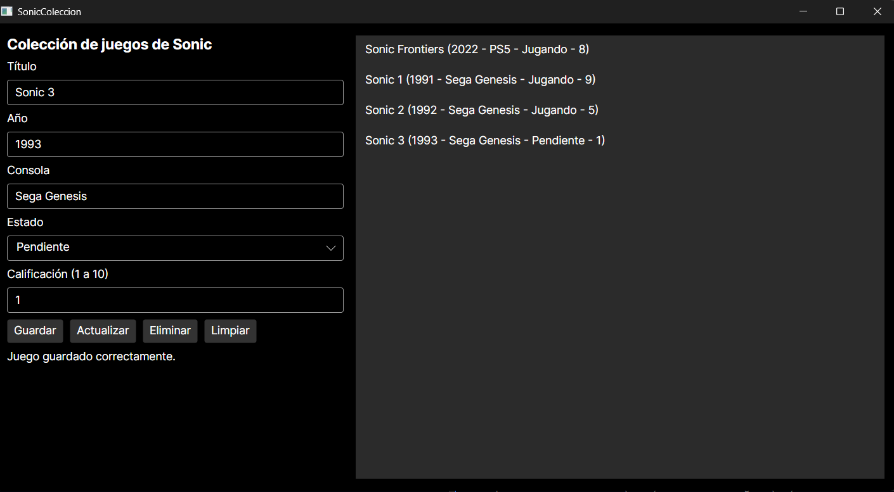
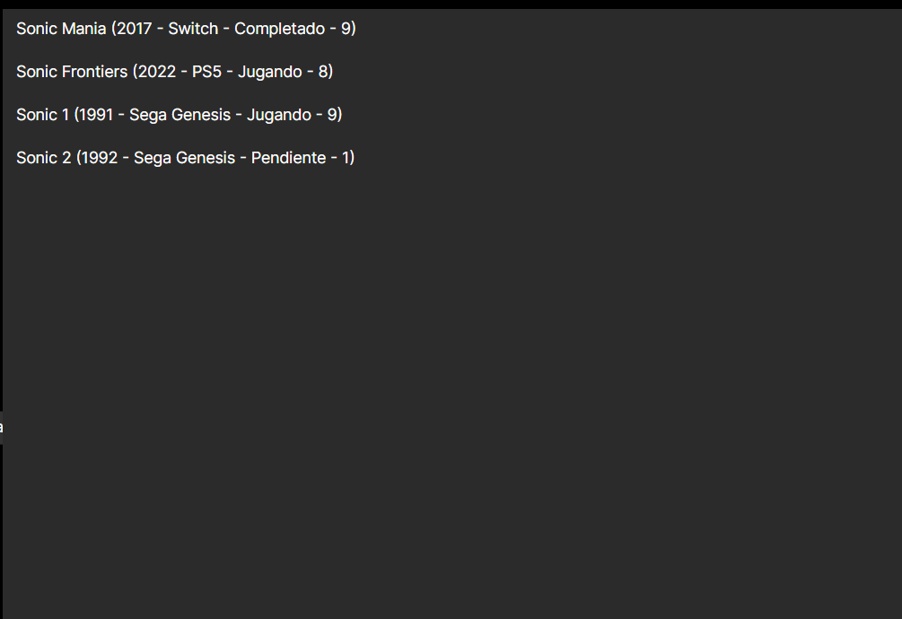
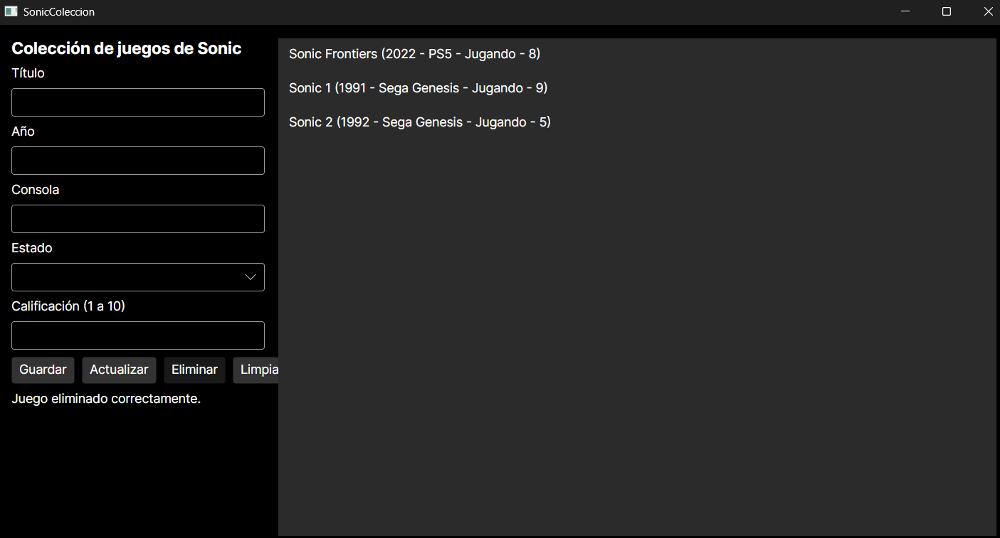
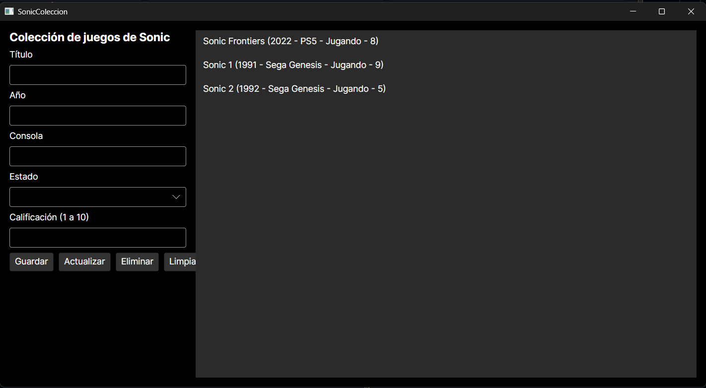

# SonicColeccion

Parcial final de Programación con C# y .NET.

## 1. Información general

- **Nombre del proyecto:** SonicColeccion
- **Estudiante:** Owhen Padilla
- **Institución:** Corporación Universitaria Americana — Ingeniería de Sistemas

### Descripción

SonicColeccion es una aplicación de escritorio para llevar el registro de una colección personal de videojuegos de Sonic. Permite guardar cada juego con su título, año de lanzamiento, consola, estado de juego y calificación, y consultar, modificar o eliminar esos registros desde una sola ventana.

### Problema que resuelve

La saga de Sonic tiene decenas de juegos repartidos entre muchas consolas. Cuando se coleccionan, es fácil perder la cuenta de cuáles se tienen, en qué plataforma, cuáles ya se terminaron y cuáles siguen pendientes. Llevar esa lista en notas sueltas o de memoria termina en datos desordenados o repetidos.

### Objetivo

Ofrecer una herramienta sencilla que guarde la colección en una base de datos local, para que la información se conserve entre sesiones y se pueda administrar sin escribir comandos.

## 2. Funcionalidades

| Operación | Qué hace |
|---|---|
| **Registrar** | Se llena el formulario y se pulsa **Guardar**. El juego se valida y se almacena en la base de datos. |
| **Consultar** | Al abrir la aplicación, la lista de la derecha muestra todos los juegos guardados. |
| **Actualizar** | Se selecciona un juego de la lista, sus datos suben al formulario, se modifican y se pulsa **Actualizar**. |
| **Eliminar** | Se selecciona un juego de la lista y se pulsa **Eliminar**. |
| **Limpiar** | Vacía el formulario y quita la selección de la lista. |

Validaciones que hace el programa antes de guardar o actualizar:

- El título, la consola y el estado no pueden estar vacíos.
- El año debe ser un número entero entre 1991 (año del primer Sonic) y el año actual.
- La calificación debe ser un número entero entre 1 y 10.

Cada operación muestra un mensaje debajo de los botones, ya sea de confirmación o con la descripción del error. Un dato incorrecto nunca cierra la aplicación.

## 3. Tecnologías utilizadas

| Tecnología | Versión | Uso |
|---|---|---|
| .NET | 10.0 | Plataforma de ejecución |
| C# | La incluida en .NET 10 | Lenguaje de programación |
| Avalonia UI | 12.1.2 | Interfaz gráfica (archivos `.axaml`) |
| ADO.NET (`Microsoft.Data.Sqlite`) | 11.0.0 | Conexión y comandos SQL |
| SQLite | Incluido en el paquete anterior | Base de datos local |

Paquetes adicionales que trae la plantilla de Avalonia: `Avalonia.Desktop`, `Avalonia.Themes.Fluent`, `Avalonia.Fonts.Inter` y `AvaloniaUI.DiagnosticsSupport`.

No se utiliza Entity Framework ni ningún otro ORM.

## 4. Estructura del proyecto

```
SonicColeccion/
├── Models/
│   └── Juego.cs               Entidad principal
├── Data/
│   ├── BaseDatos.cs           Cadena de conexión y creación de la tabla
│   └── JuegoDAO.cs            Operaciones CRUD con SQL
├── Services/
│   └── JuegoServicio.cs       Validaciones y reglas del programa
├── MainWindow.axaml           Diseño de la ventana
├── MainWindow.axaml.cs        Eventos de la ventana
├── App.axaml / App.axaml.cs   Arranque de la aplicación
├── Program.cs                 Punto de entrada
├── SonicColeccion.csproj      Proyecto y dependencias
├── evidencias/                Capturas de las pruebas
└── README.md
```

### Clases principales

| Clase | Responsabilidad |
|---|---|
| `Juego` | Representa un juego de la colección. Solo guarda datos; no conoce la ventana ni la base de datos. |
| `BaseDatos` | Sabe dónde está el archivo `sonic.db` y crea la tabla `Juegos` si no existe. |
| `JuegoDAO` | Única clase que ejecuta SQL sobre los juegos: `Insertar`, `ObtenerTodos`, `Actualizar` y `Eliminar`. |
| `JuegoServicio` | Valida los datos y decide si se llama al DAO. Expone `Registrar`, `Listar`, `Modificar` y `Borrar`. |
| `MainWindow` | Lee los controles, responde a los eventos y muestra los resultados. Solo conoce a `JuegoServicio`. |

### Cómo se relacionan

```
MainWindow  →  JuegoServicio  →  JuegoDAO  →  BaseDatos  →  sonic.db
 (interfaz)       (lógica)        (datos)
```

Ejemplo con el botón **Guardar**: el evento `BtnGuardar_Click` lee las cajas de texto y crea un objeto `Juego`; `JuegoServicio.Registrar` lo valida; si es correcto, `JuegoDAO.Insertar` ejecuta el `INSERT`; la ventana recarga la lista y muestra el mensaje. Si la validación falla, el servicio lanza una excepción con el motivo y la ventana la muestra al usuario.

### Dónde se aplica POO

- **Clases y objetos:** cada fila de la tabla se convierte en un objeto `Juego`.
- **Constructores sobrecargados:** `Juego` tiene uno de 5 parámetros para juegos nuevos, que aún no tienen identificador, y uno de 6 para juegos leídos de la base. El segundo reutiliza al primero con `: this(...)`.
- **Encapsulamiento:** `Id` tiene `private set`, porque lo asigna la base de datos y nadie más debe cambiarlo. `JuegoServicio.Validar` es `private` porque es un detalle interno del servicio. La ruta del archivo en `BaseDatos` también es privada.
- **Herencia y polimorfismo:** `Juego` sobrescribe `ToString()`, heredado de `object`. La lista de la ventana llama a ese método para mostrar cada juego sin saber de qué clase es. `MainWindow` hereda de `Window`.
- **Separación de responsabilidades:** interfaz, lógica y acceso a datos están en carpetas y clases distintas.

## 5. Instalación de dependencias

Requisitos:

- **SDK de .NET 10.0** o superior. Se descarga en <https://dotnet.microsoft.com/download>.
- **Git**, para clonar el repositorio.

Para comprobar la versión instalada:

```bash
dotnet --version
```

Pasos:

1. Clonar el repositorio:

   ```bash
   git clone <URL-del-repositorio>
   ```

2. Entrar a la carpeta del proyecto:

   ```bash
   cd SonicColeccion
   ```

3. Restaurar las dependencias (descarga Avalonia y `Microsoft.Data.Sqlite` desde NuGet):

   ```bash
   dotnet restore
   ```

No se necesita ninguna configuración adicional ni instalar SQLite por separado.

## 6. Ejecución del programa

Desde la carpeta del repositorio, donde está `SonicColeccion.csproj`:

```bash
dotnet restore
dotnet run
```

También se puede abrir `SonicColeccion.slnx` en Visual Studio 2022 o posterior y ejecutar con F5.

## 7. Base de datos

- **Qué almacena:** los juegos de la colección.
- **Archivo:** `sonic.db`, ubicado junto al ejecutable (`bin/Debug/net10.0/sonic.db`).
- **Creación:** automática. Al iniciar, `App.axaml.cs` llama a `BaseDatos.Inicializar()`, que ejecuta `CREATE TABLE IF NOT EXISTS`. No hay que ejecutar ningún script ni procedimiento previo. Por eso el archivo `.db` no se incluye en el repositorio.

### Tabla `Juegos`

| Campo | Tipo | Descripción |
|---|---|---|
| `Id` | INTEGER, clave primaria autoincremental | Identificador que asigna SQLite |
| `Titulo` | TEXT NOT NULL | Nombre del juego |
| `Anno` | INTEGER NOT NULL | Año de lanzamiento |
| `Consola` | TEXT NOT NULL | Plataforma |
| `Estado` | TEXT NOT NULL | Pendiente, Jugando o Completado |
| `Calificacion` | INTEGER NOT NULL | Nota del 1 al 10 |

### Conexión

La cadena de conexión está en `Data/BaseDatos.cs`:

```csharp
private static readonly string ruta = Path.Combine(AppContext.BaseDirectory, "sonic.db");
public static string CadenaConexion => $"Data Source={ruta}";
```

Cada método abre su propia `SqliteConnection` con `using`, de modo que la conexión se cierra sola al terminar, incluso si ocurre un error.

### Operaciones CRUD

Todas están en `Data/JuegoDAO.cs` y usan comandos parametrizados (`$titulo`, `$anno`, `$id`…), nunca texto concatenado:

| Operación | Método | SQL |
|---|---|---|
| Create | `Insertar(Juego)` | `INSERT INTO Juegos ...` |
| Read | `ObtenerTodos()` | `SELECT ... FROM Juegos` con `SqliteDataReader` |
| Update | `Actualizar(Juego)` | `UPDATE Juegos SET ... WHERE Id = $id` |
| Delete | `Eliminar(int)` | `DELETE FROM Juegos WHERE Id = $id` |

## 8. Evidencias de funcionamiento

### Prueba 1 · Registro

Se llenó el formulario con un juego nuevo y se pulsó **Guardar**. El juego apareció en la lista y se mostró el mensaje «Juego guardado correctamente».



### Prueba 2 · Consulta

Al abrir la aplicación, la lista de la derecha muestra los juegos almacenados en la base de datos.



### Prueba 3 · Actualización

Se seleccionó un juego de la lista, se cambió su calificación en el formulario y se pulsó **Actualizar**. La lista mostró el valor nuevo y el mensaje «Juego actualizado correctamente».


### Prueba 4 · Eliminación

Se seleccionó un juego y se pulsó **Eliminar**. El juego dejó de aparecer en la lista y se mostró el mensaje «Juego eliminado correctamente».



### Prueba 5 · Validación

Se intentó guardar un juego con datos incorrectos (una calificación fuera del rango de 1 a 10). El programa mostró el mensaje de error y siguió funcionando, sin guardar el registro.


### Prueba 6 · Persistencia

Se cerró la aplicación y se volvió a abrir. Los juegos registrados antes seguían en la lista.



## 9. Problemas encontrados y soluciones

### Un error de SQL que solo aparecía al ejecutar

Al escribir la creación de la tabla quedó `CREATE TABLE IF NO EXISTS` en lugar de `IF NOT EXISTS`. El proyecto compilaba sin problema, porque para C# el SQL es solo un texto, pero la aplicación fallaba al arrancar. Lo engañoso fue que el archivo `sonic.db` sí aparecía en la carpeta: lo crea `conexion.Open()`, aunque la tabla nunca llegó a existir. Se resolvió leyendo el mensaje de la excepción de SQLite, que señalaba la palabra `NO`, y corrigiendo la sentencia.

### La lista salía vacía sin ningún error

En `ObtenerTodos` el ciclo estaba escrito como `while (lector.NextResult())`. Ese método pasa al siguiente conjunto de resultados, no a la siguiente fila, así que devolvía `false` desde el inicio y el método entregaba una lista vacía sin lanzar ningún error. Se resolvió cambiándolo por `lector.Read()`, que es el que avanza fila por fila.

### Dónde guardar el archivo de la base de datos

Con una ruta relativa simple (`sonic.db`), el archivo se crea en la carpeta desde la que se lanza el programa, que cambia según se ejecute desde Visual Studio o con `dotnet run`. Eso podía dar la impresión de que los datos se perdían. Se resolvió armando la ruta con `AppContext.BaseDirectory`, para que el archivo quede siempre junto al ejecutable.
